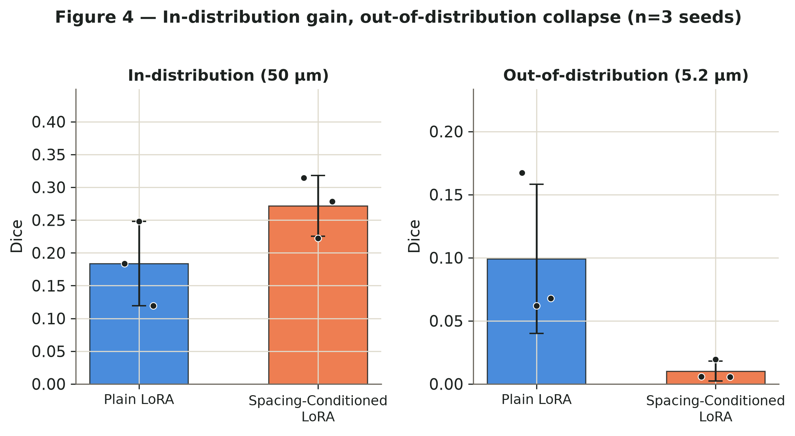
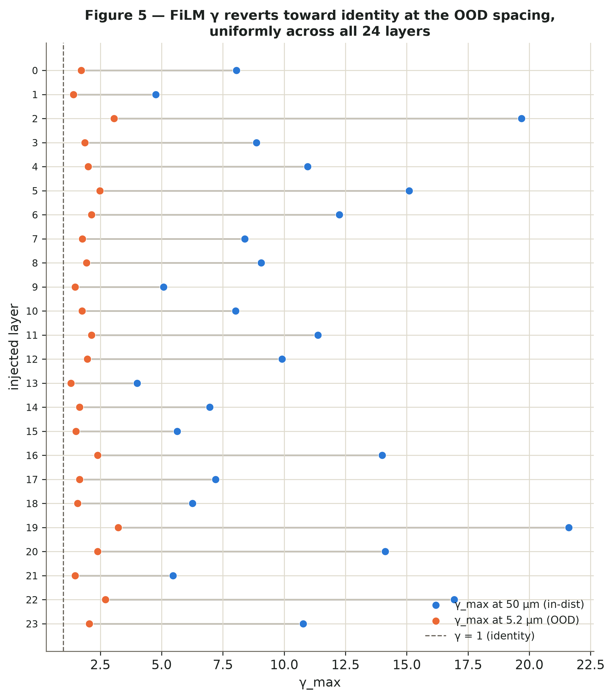
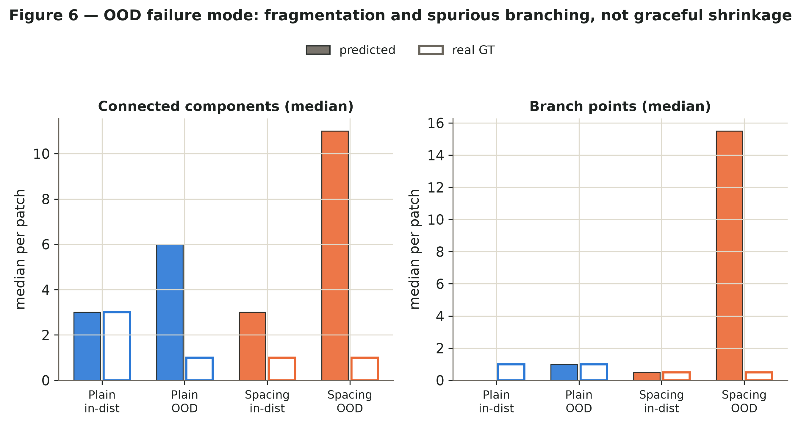

# Spacing-aware LoRA for multi-resolution HiP-CT vessel segmentation

LoRA (with and without spacing-conditioned FiLM) on a frozen SAM-Med3D encoder, tested on human kidney vessels at 63, 50, 13 and 5.2 µm ([SenNet + HOA](https://www.kaggle.com/competitions/blood-vessel-segmentation) data, Jain et al. 2026).

* **Setup:** `pip install -r requirements.txt`, clone SAM-Med3D and clDice into `external/`, then `python -m utils.patch_external_repos`.
* **Train:** `python train_lora_v2.py --model spacing --spacing-encoding log --fov-scale 0.25 2.0 --patch 128 --refine --seed 0 --out checkpoints_v2/s_aug_s0`
* **Evaluate:** `python -m benchmark.infer ...`, then `python -m benchmark.score ...` and `python -m benchmark.aggregate --results results/scores`.
* **Layout:** `models/`, `losses/`, `utils/` (code) · `benchmark/` (test ROIs, scoring, baselines) · `kaggle_kernels/` (Kaggle jobs and notebooks) · `results/` (scores) · `first_round/` (first experiments).
* **Tests:** `python -m pytest tests -q`

   First-round figures: Dice in/out of distribution (4), FiLM γ per layer (5), connected components and branch points (6).

Data: Human Organ Atlas / SenNet + HOA (Jain et al., *Nat. Commun.* 17:8273, 2026). The paper is in preparation.
